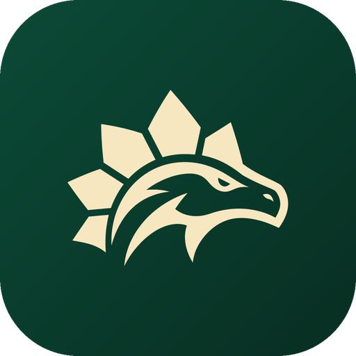

<p align="center">
  
</p>

<h1 align="center">Razarsa</h1>
<p align="center"><b>Satu aplikasi untuk mengatur hidup.</b><br>Keuangan dan produktivitas dalam satu tempat, untuk Android dan Windows.</p>
<p align="center"><a href="../../releases/latest"><b>⬇️ Unduh versi terbaru</b></a></p>

---

Aplikasi Flutter dengan dua mode: **Keuangan** dan **Produktif**. Semua data tersimpan di perangkat, tanpa akun dan tanpa server.

## Fitur

**💰 Keuangan**
- Catat pemasukan dan pengeluaran, Catat Cepat sekali tap
- Laporan, anggaran bulanan dan per kategori, target tabungan
- Transaksi berulang dan pengingat tagihan
- Saldo per sumber (bank, e-wallet, tunai) dengan graph bulat per kuartal

**✅ Produktif**
- Tugas, kalender dengan pengingat
- Catatan dengan folder, sematan, dan kunci PIN (terenkripsi)

**Umum**
- Terang/gelap, Indonesia/English, palet warna yang bisa diatur
- Tampilan polos secara bawaan; **Pakai latar** menyalakan ilustrasi Gurun Senja (Keuangan) dan ruang kerja (Produktif) dengan efek kaca
- **Kurangi efek** mematikan blur dan animasi untuk perangkat lama
- Foto profil dan sampul dari galeri/berkas sendiri
- Kunci PIN dan sidik jari (Windows Hello di Windows)
- Backup berkata sandi, pulihkan, ekspor CSV
- Profil dengan level, avatar, bingkai, dan lencana

## Platform

| | Android | Windows (64-bit) |
|---|---|---|
| Keuangan dan Produktif | ✅ | ✅ |
| Tampilan | menu bawah | sidebar, bilah cari, palet perintah |
| Pengingat/notifikasi | ✅ | ❌ (belum ada) |
| Cegah tangkapan layar | ✅ | ❌ |
| Kunci biometrik | sidik jari | Windows Hello |

Data tiap perangkat terpisah. **Belum ada sinkron otomatis**; untuk memindahkan data, buat backup di satu perangkat lalu pulihkan di perangkat lain (format sama di Android dan Windows). Sinkron antar perangkat direncanakan sebagai pilihan di pembaruan berikutnya.

### Pintasan keyboard (Windows)

| Pintasan | Fungsi |
|---|---|
| `Ctrl+1` … `Ctrl+5` | Beranda, Transaksi, Saldo, Laporan, Target |
| `Ctrl+6` … `Ctrl+9` | Hari ini, Tugas, Kalender, Catatan |
| `Ctrl+,` | Pengaturan |
| `Ctrl+K` / `Ctrl+N` | Palet perintah: cari halaman atau transaksi, catat baru, ganti tema |
| `Ctrl+L` | Kunci aplikasi (butuh PIN aktif) |
| `Ctrl+B` | Ciutkan atau lebarkan sidebar |
| `Esc` | Tutup palet atau dialog |

## Pasang

**Android**
1. Buka halaman [**Releases**](../../releases/latest).
2. Unduh **`…-arm64.apk`** (hampir semua HP modern) atau `…-universal.apk`.
3. Pasang. Izinkan "sumber tidak dikenal" jika diminta.

**Windows**
1. Unduh **`…-windows-x64.zip`** dari [Releases](../../releases/latest) dan ekstrak ke satu folder.
2. Jalankan `razarsa.exe`.
3. File belum ditandatangani digital, jadi Windows bisa menampilkan peringatan SmartScreen: pilih "Informasi lebih lanjut" lalu "Tetap jalankan".

## Pengembangan

Butuh Flutter 3.47. Build Windows hanya bisa dibuat di Windows (Visual Studio dengan beban kerja "Desktop development with C++").

```bash
flutter pub get --enforce-lockfile
flutter analyze --fatal-infos
flutter test
flutter run                 # Android
flutter run -d windows      # Windows
flutter build apk --release
flutter build windows --release
```

Jendela selebar 900 px atau lebih memakai kerangka desktop; yang lebih sempit memakai tampilan HP.

Dokumen: [Keamanan](SECURITY.md) · [Laporan audit](docs/AUDIT.md)

## Lisensi

Hak cipta © 2026 Razarsa. Semua hak dilindungi: kode dan ilustrasi tidak boleh disalin, diubah, atau disebarkan ulang tanpa izin tertulis. Lihat [LICENSE](LICENSE).

Pengecualian: font Plus Jakarta Sans memakai SIL Open Font License.
