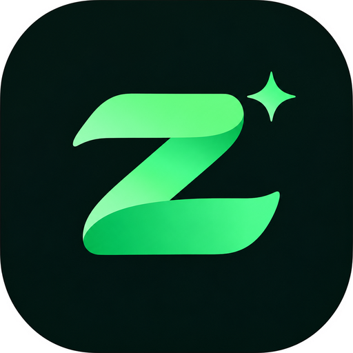

<p align="center">
  
</p>

<h1 align="center">Razarsa</h1>
<p align="center"><i>Dari nama pembuatnya: <b>Ra</b>ihan <b>Za</b>fran Sy<b>a</b>ddat (dulu bernama Zevra)</i></p>
<p align="center"><b>Satu aplikasi untuk mengatur hidup.</b><br>Keuangan, produktivitas, dan kesehatan dalam satu tempat.</p>

---

## Apa itu Razarsa?

Razarsa adalah aplikasi Android berbasis **Flutter** yang dirancang sebagai **"multi app"**: satu aplikasi dengan beberapa *mode*, dan setiap mode mengurus satu bagian hidup.

Banyak orang memasang 4–5 aplikasi berbeda untuk mencatat uang, daftar tugas, catatan, latihan, dan kesehatan. Datanya tersebar, tampilannya beda-beda, dan semuanya harus dibuka satu per satu. Razarsa menyatukan semuanya dengan tampilan yang konsisten, satu pengaturan, dan satu teman maskot: **naga hijau kecil** yang ikut senang kalau kamu konsisten.

## Tujuan

1. **Mudah dan cepat.** Mencatat sesuatu harus selesai dalam hitungan detik, contohnya lewat tombol *Catat Cepat*.
2. **Semua di satu tempat.** Pindah mode cukup lewat satu tombol, dan pengaturannya tetap satu untuk semua mode.
3. **Saling terhubung.** Contoh ke depannya: tagihan otomatis jadi pengingat, dan latihan tercatat di kesehatan.
4. **Nyaman dilihat.** Ada mode terang dan gelap, animasi halus, dan latar yang ikut berganti siang dan malam.
5. **Data milik pengguna.** Versi awal menyimpan semua data **di HP**, tanpa server.

## Rencana mode

| Mode | Isi | Status |
|---|---|---|
| 💰 **Keuangan** | Catat pemasukan dan pengeluaran, laporan, anggaran, target tabungan | ✅ Versi 1 |
| ✅ **Produktif** | To-do, pengingat, catatan | 🔜 Berikutnya |
| 💪 **Gym** | Home workout: program latihan, timer, riwayat | 🔜 Direncanakan |
| ❤️ **Health** | Air minum, tidur, berat badan, langkah | 🔜 Direncanakan |
| 🏠 **Dashboard Utama** | Ringkasan semua mode setelah login, plus tombol ganti mode | 🔜 Direncanakan |

## Fitur versi 1 (mode Keuangan)

- **Masuk / Daftar**: empat karakter lucu yang mengintip saat kata sandi diketik, sedih kalau data salah, dan senang kalau berhasil. Ada juga pilihan *Lanjut tanpa akun*.
- **Beranda**: total saldo, pemasukan dan pengeluaran bulan ini, tombol **+ Pengeluaran** dan **+ Pemasukan**, **Catat Cepat** sekali tap (dengan tombol *Batalkan*), dan transaksi terbaru.
- **Tambah transaksi**: kategori yang paling sering dipakai tampil duluan, 19 kategori khas Indonesia (Kos, Cicilan, Kondangan, Sedekah, THR, dll.), bisa **bikin kategori sendiri**, dan bisa pilih tanggal.
- **Transaksi**: riwayat per hari, filter Pemasukan/Pengeluaran, tekan lama untuk menghapus.
- **Laporan**: anggaran bulanan (bisa diubah), grafik tren 6 bulan, **donut** pembagian belanja per kategori, dan maskot yang ikut cemas kalau anggaran hampir habis.
- **Target**: target tabungan dengan progres. Gambar gunung berganti siang dan malam.
- **Pengaturan**: satu untuk semua mode. Isinya tema (Terang/Gelap/Ikuti HP), anggaran, notifikasi, keamanan, **sembunyikan saldo**, hapus data, dan keluar.
- **Dock** dengan bola hijau yang **melompat** ke menu yang dipilih.
- **Latar animasi**: siang ada awan, burung, dan pesawat kertas; malam ada bintang dan **kunang-kunang**. Semua animasi otomatis berhenti kalau HP memakai pengaturan *kurangi gerakan*.

> **⚠️ Login versi beta belum aman:** masih **lokal**, kata sandi **tidak dicek**, akun hanya tersimpan di HP. Cocok untuk uji coba, bukan untuk data sungguhan. Nanti akan memakai Firebase. Tombol "Masuk dengan Google", backup, ekspor, dan beberapa menu Pengaturan masih bertanda *segera hadir*.

## Cara mendapatkan APK

APK dibuat otomatis oleh **GitHub Actions** setiap ada push.

1. Buka tab **Actions** di repo ini.
2. Pilih run **Build APK** terbaru yang berhasil (centang hijau).
3. Di bagian **Artifacts**, unduh file berawalan **razarsa-v…**. File yang diunduh berbentuk zip, ekstrak dulu. Di dalamnya ada dua APK:
   - **`…-arm64.apk`** (sekitar 20 MB): **pilih ini** untuk hampir semua HP Android keluaran 2017 ke atas.
   - **`…-universal.apk`** (sekitar 55 MB): untuk semua HP, termasuk HP lama dan emulator.
4. Pasang di HP Android (izinkan "instal dari sumber tidak dikenal").

Kalau kamu push tag berawalan `v` (contoh `v1.0.0`), APK juga otomatis muncul di halaman **Releases**.

### Supaya APK bisa di-update tanpa uninstall

Isi secret **`DEBUG_KEYSTORE_BASE64`** di *Settings → Secrets and variables → Actions*. Dengan begitu setiap build ditandatangani kunci yang sama. Tanpa secret ini, APK tetap jadi, tapi tiap build punya kunci berbeda, jadi aplikasi lama harus dihapus dulu sebelum memasang yang baru.

## Struktur kode

```
lib/
├── main.dart                 # Titik awal aplikasi, tema, login atau aplikasi
├── core/
│   ├── theme.dart            # Warna mode terang & gelap (berganti halus)
│   └── format.dart           # Format Rupiah, tanggal, sapaan
├── data/
│   ├── models.dart           # Transaksi, kategori, target, Catat Cepat
│   └── store.dart            # Penyimpanan data di HP (shared_preferences)
├── shell/
│   ├── app_shell.dart        # Kerangka: latar, perpindahan halaman, dock
│   ├── dock.dart             # Dock dengan lekukan & bola yang melompat
│   └── sky_background.dart   # Latar siang/malam beranimasi
├── features/
│   ├── auth/                 # Masuk/Daftar + karakter kawaii
│   ├── finance/              # Beranda, Transaksi, Tambah, Laporan, Target
│   └── settings/             # Pengaturan & Profil
└── widgets/common.dart       # Komponen yang dipakai bersama
```

Setiap mode baru nanti cukup ditambahkan sebagai folder baru di `lib/features/`, tanpa membongkar yang sudah ada.

## Menjalankan di komputer

Butuh **Flutter 3.47** dan **Android SDK**.

```bash
flutter pub get
flutter run            # jalankan di HP / emulator
flutter test           # jalankan tes
flutter build apk      # buat APK
```

## Keamanan

File berikut **tidak boleh** masuk ke repo ini, dan sudah dicegah lewat `.gitignore`:

- `debug.keystore` / `*.jks`: kunci tanda tangan APK
- `google-services.json`: konfigurasi Firebase
- isi base64 keystore

Simpan semuanya di **GitHub Secrets**, jangan di kode. APK rilis ditandatangani **kunci rilis** dari secret `RELEASE_KEYSTORE_BASE64`, `RELEASE_STORE_PASSWORD`, `RELEASE_KEY_PASSWORD`, `RELEASE_KEY_ALIAS`.

## Lisensi aset

- Font **Plus Jakarta Sans** memakai lisensi SIL Open Font License (`assets/fonts/OFL.txt`).
- Maskot dan ilustrasi adalah aset milik pemilik proyek Razarsa.
